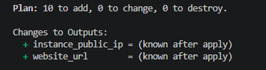
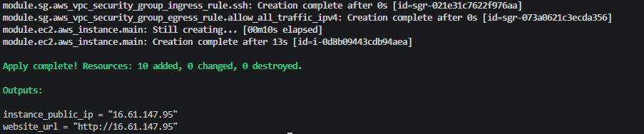
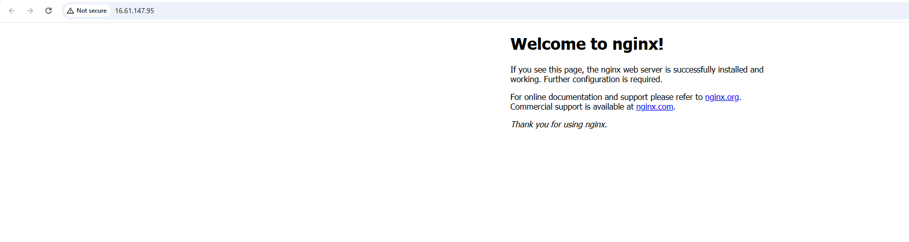

# AWS EC2 Automated Deployment with Terraform & Cloud-Init

## Overview

This project demonstrates the automated provisioning and configuration of an AWS EC2 instance using **Terraform and Cloud-Init**.

Terraform provisions the AWS infrastructure using reusable modules, while Cloud-Init automates server configuration, user creation, security settings and NGINX installation during instance boot.

The entire deployment is completed without manually SSHing into the server.

## Technologies Used

- **AWS:** EC2, VPC, Subnets, Internet Gateway, Route Tables, Security Groups
- **Terraform:** Infrastructure as Code (IaC), modular infrastructure
- **Cloud-Init:** Automated Linux server configuration
- **Linux:** Ubuntu, NGINX, SSH

## Implementation

- Provisioned a custom VPC, public subnet, Internet Gateway and routing configuration.
- Created reusable Terraform modules for networking, security groups and EC2.
- Configured inbound HTTP (80) and restricted SSH (22) access.
- Automated system updates, user creation and SSH security configuration using Cloud-Init.
- Installed and enabled NGINX automatically during EC2 initialization.
- Exposed the EC2 public IP and website URL through Terraform outputs.

### Cloud-Init Configuration

View the [Cloud-Init YAML configuration](modules/ec2/user-data.yaml) used to automate server setup.

## Deployment Verification

### 1. Terraform Plan

Terraform identified **10 resources** to provision.

### 2. Terraform Apply

Successfully deployed all 10 AWS resources with no errors.

### 3. NGINX Web Server

Verified that NGINX was accessible through the EC2 instance's public IP without manual server configuration.

## Key Takeaway

This project demonstrates how **Terraform and Cloud-Init** work together to automate infrastructure provisioning and server configuration, reducing manual setup and improving deployment consistency.
